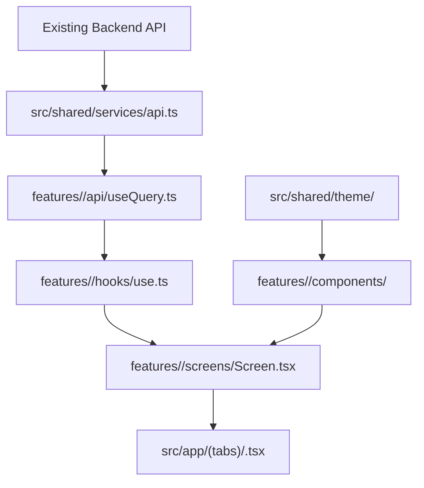

# WeekBite Mobile Architecture Guide

This document defines the **Feature-Driven Architecture** and architectural rules governing the [`apps/mobile`](file:///d:/Projects/weekbite-client/apps/mobile) workspace.

---

## 1. Directory Blueprint

```text
apps/mobile/
├── assets/                     # App icons, splash screens, local illustration SVGs
├── AGENTS.md                   # Strict mobile-specific AI agent instructions
├── DESIGN.md                   # Design tokens, colors, typography, touch target rules
├── ARCHITECTURE.md             # This document
│
├── src/
│   ├── app/                    # Routing & Navigation layer (Expo Router)
│   │   ├── (auth)/             # Auth route group (sign in, sign up, forgot password)
│   │   ├── (tabs)/             # Main tab group (Compass, Recipes, Groceries, Profile)
│   │   ├── _layout.tsx         # Root layout, theme providers, splash screen handling
│   │   └── navigation/         # Navigation helpers & typed route parameters
│   │
│   ├── features/               # ⭐️ CORE BUSINESS DOMAINS (Isolated & self-contained)
│   │   ├── auth/               # Login, registration, token refresh
│   │   ├── meals/              # Weekly Compass, day planner, meal slot assignment
│   │   ├── groceries/          # Auto-generated grocery checklist & pantry sync
│   │   ├── recipes/            # Recipe discovery, prep times, step-by-step cooking
│   │   └── profile/            # Dietary goals, allergies, household portion sizing
│   │
│   ├── shared/                 # ⭐️ CROSS-CUTTING REUSABLES
│   │   ├── components/         # Base UI primitives (Button, Input, Card, Modal, Badge)
│   │   ├── theme/              # Color palette, spacing, typography tokens
│   │   ├── services/           # Network client, API interceptors, error reporting
│   │   ├── storage/            # MMKV storage keys & secure store wrappers
│   │   ├── hooks/              # Global hooks (useOnlineStatus, useDebounce)
│   │   └── utils/              # Date/calendar math, currency formatters
│   │
│   └── types/                  # Global app types & environment declarations
│
├── app.json                    # Expo project configuration
├── package.json
└── tsconfig.json
```

---

## 2. Anatomy of a Feature Folder

Each feature module is structured as a self-contained unit:

```text
features/<feature-name>/
├── api/             # TanStack Query hooks & fetch mutations
├── components/      # UI components used exclusively by this feature
├── hooks/           # Custom hooks encapsulating local domain logic
├── screens/         # Full-screen views composed from components
├── types/           # Domain schemas & DTO interfaces
└── index.ts         # Public API surface of this feature
```

---

## 3. Core Architectural Rules

### Rule 1: Feature Isolation
- A feature module can import from `src/shared/`.
- A feature module **must NEVER** import directly from another feature’s internal folders (e.g. `features/meals` must not import from `features/groceries/components`).
- If code is needed by more than one feature, promote it to `src/shared/`.

### Rule 2: Thin Route Files
Route files in `src/app/` should be minimal (typically under 15 lines). Their sole responsibility is to import and render a screen from `src/features/<feature>/screens/`:
```tsx
// src/app/(tabs)/compass.tsx
import { CompassScreen } from '@/features/meals/screens/CompassScreen';

export default function CompassRoute() {
  return <CompassScreen />;
}
```

### Rule 3: Colocation Principle
Keep tests, types, and presentation components as close to where they are consumed as possible. Do not create global dumping-ground folders for types or components that belong to only one feature.

---

## 4. Data Flow & Monorepo Integration


